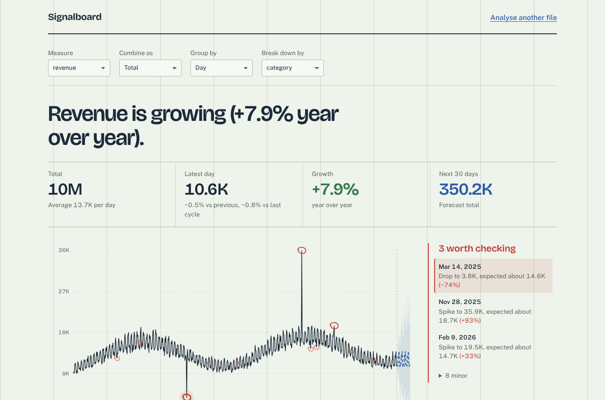
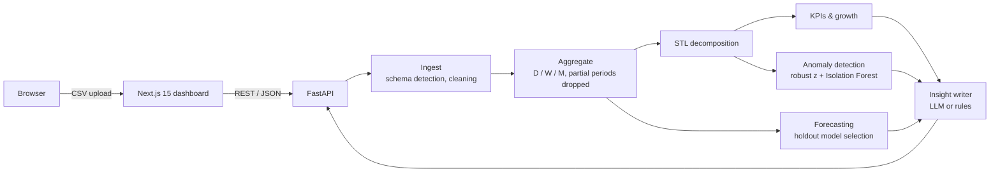

# Signalboard

Upload a CSV of business data and get back what changed, what comes next, and what looks wrong — as numbers you can check and sentences you can act on.



## What it does

| Question | How Signalboard answers it |
| --- | --- |
| Is it growing? | Year-over-year growth when there are two full years of data, otherwise a linear trend fitted to the deseasonalised series. |
| What happens next? | Three forecasting models compete on a holdout window; the most accurate one produces the forecast with 80% and 95% ranges. |
| What looks wrong? | Seasonal decomposition plus robust z-scores and an Isolation Forest flag spikes and drops, ranked by severity. |
| What drove the change? | Segment-level comparison against the same window last season, so normal seasonality isn't mistaken for decline. |
| So what? | Plain-English findings and next actions, written by an LLM from the computed figures, or by rule-based templates when no API key is set. |

It works on any CSV with a date column and a numeric column: it detects the schema itself, cleans currency strings like `$1,234` or `AED 500`, and picks a sensible daily, weekly or monthly grain.

## Architecture



```
signalboard/
├── backend/
│   ├── app/
│   │   ├── main.py              # FastAPI routes
│   │   ├── store.py             # in-memory dataset store (TTL + LRU cap)
│   │   └── services/
│   │       ├── ingest.py        # CSV parsing, schema detection, cleaning
│   │       ├── kpis.py          # aggregation, growth, KPIs, top movers
│   │       ├── decompose.py     # shared STL decomposition
│   │       ├── forecast.py      # model competition + prediction intervals
│   │       ├── anomaly.py       # statistical + ML anomaly detection
│   │       └── insights.py      # LLM / rule-based narrative
│   ├── scripts/
│   │   ├── generate_sample.py   # builds the sample retail dataset
│   │   └── evaluate.py          # reproducible accuracy benchmark
│   ├── tests/                   # pytest suite (20 tests)
│   └── Dockerfile
└── frontend/
    ├── app/                     # Next.js app router
    ├── components/              # chart, ledger, margin notes, tables
    └── lib/                     # API client, types, formatting
```

## How the analysis works

**Decomposition.** Each series is split into trend, seasonal and residual parts with STL. Default STL windows are so tight that they absorb ordinary noise, which made normal days look extreme; Signalboard widens both windows and works in log space for positive data, so multiplicative seasonality ("weekends are 18% higher") is modelled correctly.

**Forecasting.** A seasonal-naive baseline, Holt's damped trend and Holt-Winters are each trained without the most recent periods and scored on them (MAE, MAPE, sMAPE). The winner is refitted on the full history. Prediction intervals come from residual spread and widen with the horizon. If nothing beats the baseline, the dashboard says so instead of presenting a weak model as accurate.

**Anomaly detection.** Residuals are scored with a median/MAD robust z-score, which a few extreme points can't inflate. An Isolation Forest over engineered features (residual, period-on-period change, deviation from expected) catches points that are unusual in combination. Severity thresholds were tuned on one set of synthetic series and reported on a separate held-out set.

**Insights.** All figures are computed deterministically first. The LLM only phrases them and is instructed not to introduce numbers; any failure falls back to the rule-based writer, so the dashboard never breaks on an API error.

## Evaluation

`python backend/scripts/evaluate.py` generates 200 synthetic daily series with random trend, weekly and yearly seasonality, noise, and 2–5 injected anomalies each (a mix of subtle and obvious spikes and drops). Thresholds were tuned on seeds 0–99; these results are on unseen seeds 1000–1199.

| Metric | Result |
| --- | --- |
| Anomaly precision | 97.4% |
| Anomaly recall | 98.8% |
| Anomaly F1 | 0.981 |
| Forecast MAPE, 28-day out-of-sample (mean) | 6.37% vs 7.80% seasonal-naive |
| Forecast error reduction vs baseline | 18.3% |
| Analysis time | ~0.6 s per two-year daily series |

Full output is in [`EVALUATION.txt`](EVALUATION.txt). These are synthetic benchmarks with known ground truth; real-world accuracy depends on the data.

## Run it locally

**Backend** (Python 3.11+)

```bash
cd backend
pip install -r requirements.txt
cp .env.example .env            # optional: add ANTHROPIC_API_KEY for LLM insights
uvicorn app.main:app --reload --port 8000
```

API docs: http://localhost:8000/docs

**Frontend** (Node 20+)

```bash
cd frontend
npm install
cp .env.example .env.local      # NEXT_PUBLIC_API_URL=http://localhost:8000
npm run dev
```

Open http://localhost:3000 and choose **Use sample retail data**. The sample has three planted anomalies (a payment outage, a flash sale and a duplicated import) which should be the top three flags on the daily view.

**Tests**

```bash
cd backend && pytest -q
```

## Deploy

- **Backend:** any Docker host (Render, Railway, Fly.io). Set `CORS_ORIGINS` to the frontend URL and optionally `ANTHROPIC_API_KEY`.
- **Frontend:** Vercel, with `NEXT_PUBLIC_API_URL` pointing at the backend.

## API

| Method | Path | Purpose |
| --- | --- | --- |
| `GET` | `/api/health` | Status and whether LLM insights are enabled |
| `POST` | `/api/datasets` | Upload a CSV (multipart, ≤ 15 MB); returns detected schema and profile |
| `POST` | `/api/datasets/sample` | Load the bundled sample dataset |
| `POST` | `/api/analyze` | Run the analysis for a chosen date, metric, grain and optional breakdown |

## Known limitations

- Datasets live in memory for an hour on a single instance; production would use Redis or object storage.
- Daily forecasts model weekly seasonality but not yearly cycles; with long daily histories the weekly or monthly view is usually more accurate.
- Holt-Winters needs at least two full seasonal cycles of training data, so it's skipped for short weekly and monthly series.
- Large uploads are capped at 500,000 rows.

## Roadmap

- Persistent storage and user accounts
- Multi-metric correlation ("revenue fell when conversion dropped")
- Holiday and promotion calendars as forecast regressors
- Scheduled re-analysis with email alerts on new anomalies
